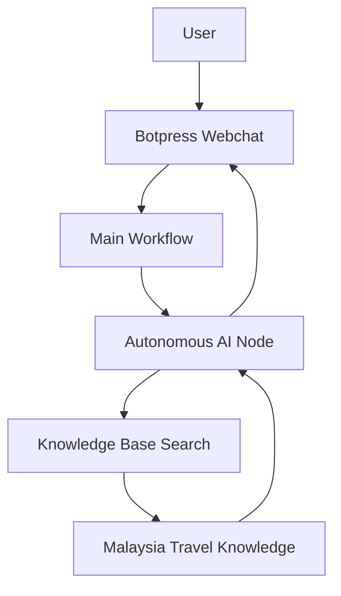

# Voyageur — Malaysia Travel Assistant

**A conversational AI travel assistant for personalized Malaysia travel planning.**

Voyageur is a Botpress-based conversational AI project designed to assist users in planning trips around Malaysia. Its agent instructions guide conversations through accommodation, attractions, and food recommendations using a supplied travel knowledge base.

This repository documents a recovered academic project. The export has been inspected locally, but live behavior and re-import have not yet been verified.

## 1. Problem

Planning a trip involves researching accommodation, attractions, food, budgets, and location-specific preferences across multiple sources.

Voyageur aims to simplify this process through a conversational assistant that gathers travel preferences and uses a supplied knowledge base to provide relevant travel suggestions.

## 2. Architecture

Voyageur is built using Botpress Studio and an autonomous AI node connected to a travel knowledge base.



- **Main Workflow:** Connects the conversation from the Start node to the Autonomous Node.
- **Autonomous AI Node:** Uses agent instructions to guide travel-planning conversations.
- **Knowledge Base Search:** Retrieves information from the supplied Malaysia travel knowledge source.
- **Additional Workflows:** Separate Error, Timeout, and Conversation End workflows are included.

The export contains no registered custom list or pattern entities. Entity and intent descriptions appear within the knowledge text rather than being implemented as separately registered entity extractors.

## 3. Tech Stack

| Technology | Purpose |
|---|---|
| Botpress Studio | Conversational AI development platform |
| Autonomous AI Node | Conversation reasoning and response generation |
| Botpress Knowledge Base | Travel information retrieval |
| Botpress Webchat | User-facing conversational interface |

## 4. Demo and Access

### Shared Webchat

[Open Voyageur Webchat](https://cdn.botpress.cloud/webchat/v3.7/shareable.html?configUrl=https://files.bpcontent.cloud/2026/04/01/08/20260401083202-0EDPDYQT.json)

The shared webchat link was supplied by the project owner. Availability and responses have not yet been manually confirmed.

### Open or Restore the Project

1. Prefer opening the existing Voyageur bot through Edit in Studio.
2. Keep the original export privately as the untouched recovery backup.
3. If testing an import, create a separate test bot.
4. Use Studio's Import / Export menu to import the metadata-cleaned `.bpz` file into the test bot.
5. Confirm the knowledge source appears and is indexed.
6. Test the autonomous node's knowledge retrieval.
7. Run the manual tests in Studio's emulator.
8. Check the existing shared webchat.

Do not publish over the existing bot until testing is complete.

## 5. Designed Behavior

Voyageur's agent instructions are designed to:

- Gather the user's destination and stay duration.
- Ask whether accommodation is already arranged.
- If accommodation is needed, gather budget and amenity preferences.
- Recommend attractions based on interests, accessibility needs, and proximity to accommodation.
- Suggest food places based on cuisine, budget, and location.
- Handle users who ask about attractions or food before completing other planning steps.
- Respond in English with occasional translated French expressions.
- Use knowledge-base information and acknowledge unsupported requests.

These are configured instructions, not measured guarantees.

No booking, live pricing, or map-routing integration was found in the inspected main workflow.

## 6. Challenges and Limitations

This project was recovered from an existing Botpress export, and its current configuration has not yet been fully verified.

- **Recovery and compatibility:** The metadata-cleaned export has not been tested for import compatibility.
- **Knowledge retrieval:** The knowledge source's indexing and retrieval behavior need to be confirmed in Studio.
- **Live behavior:** The shared webchat and conversational flows require manual testing.
- **Travel data reliability:** Prices, ratings, availability, and accessibility details have not been independently verified.
- **Configuration limitations:** No registered custom list or pattern entities were found in the export.
- **Data ownership:** Source ownership and attribution should be reviewed before publishing knowledge files.

The recovered knowledge source contains accommodation, attraction, food, and travel reference information. These are project reference data, not verified current travel advice.

## 7. Repository Structure and Next Steps

### Repository Files

```text
Voyageur/
├── botpress/
│   └── voyageur-metadata-cleaned.bpz
├── docs/
│   ├── agent-instructions.md
│   ├── manual-tests.md
│   └── recovery-review.md
├── knowledge/
│   ├── malaysia-travel.html
│   └── malaysia-travel.txt
└── README.md
```

- `botpress/voyageur-metadata-cleaned.bpz` — recovered export copy with session metadata, historical version references, table editor identities, and a stale generated bot summary removed. Operational bot/file IDs remain.
- `docs/agent-instructions.md` — original main-node instructions in readable form.
- `knowledge/malaysia-travel.html` — recovered rich-text knowledge source.
- `knowledge/malaysia-travel.txt` — readable extraction of the knowledge source.
- `docs/manual-tests.md` — manual checks to perform before claiming the project works.
- `docs/recovery-review.md` — recovery findings and remaining issues.

### Next Steps

- Verify the recovered bot configuration in Botpress Studio.
- Test knowledge-base indexing and retrieval.
- Execute the manual test scenarios.
- Capture screenshots of the workflow, knowledge source, and successful conversations.
- Review source ownership and attribution.
- Document verified results and limitations.

## Portfolio Evidence

Before presenting Voyageur as a fully functioning project, add:

- A screenshot of the Main workflow and knowledge source in Botpress Studio.
- Screenshots of successful accommodation, attraction, and food conversations.
- Results from the documented manual test cases.
- A precise description of personal contributions if this was a team project.

Do not claim evaluation metrics until test results have been recorded.

## Author

Ahad Khan
